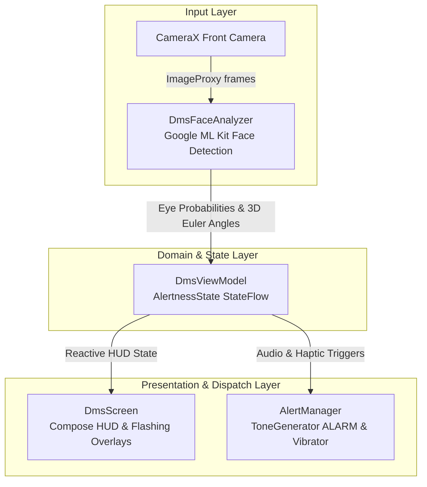

# Driver Monitoring System (DMS) for Android

<p align="center">
  
  
  
  
  
  
  
</p>

An intelligent, on-device **Driver Monitoring System (DMS)** Android application built with modern **Jetpack Compose**, **CameraX**, and **Google ML Kit Face Detection**. The app actively monitors driver alertness in real-time through the front-facing camera and issues multi-modal audiovisual warnings if signs of drowsiness or distraction are detected.

---

## ⚡ Key Highlights

- **🔒 100% On-Device & Private**: All computer vision inferences run locally using bundled ML Kit models. No camera frames or telemetry are recorded, stored, or transmitted.
- **⚡ Zero-Latency Pipeline**: Real-time eye-openness and 3D head-pose telemetry processed frame-by-frame via CameraX `ImageAnalysis`.
- **🚨 Multi-Modal Alerting**: Immediate audible alarm beeps (`ToneGenerator STREAM_ALARM`), hardware haptics (`VibratorManager`), and visual flashing overlays.
- **💬 Universal Floating Bubble Overlay**: Runs as an Android Foreground Service with a draggable, floating status badge over any app (navigation, music players, phone launcher, etc.) so driver monitoring remains uninterrupted during multitasking.
- **🔋 OLED Battery Saver Mode**: Shuts off the live camera preview to reduce device thermals and battery consumption while keeping alertness tracking fully active.

---

## 🚀 Features

### 👁️ Real-Time Drowsiness Detection
Tracks **left and right eye-open probabilities** to distinguish natural eye blinks from prolonged eye closure (microsleeps):
- **Warning Stage (Eyes closed > 1.0s)**: Pulsing amber warning HUD border and advisory prompt tone.
- **Critical Stage (Eyes closed > 1.8s)**: High-priority flashing red screen overlay, persistent alarm sirens, and continuous haptic vibrations.

### 🚗 Head Pose & Distraction Tracking
Monitors the driver's head orientation across 3D Euler angles:
- **Yaw (Left / Right)**: Triggers distraction alerts when looking away from the road (> 28°).
- **Pitch (Up / Down)**: Triggers alerts when tilting downward toward a phone or lap (> 22°).
- **Face Absence**: Triggers an alert when the driver's face leaves the camera frame for an extended period (> 1.5s).

### 💬 Background Floating Bubble (System-Wide Overlay)
Drivers can multitask or use any other app (navigation, audio players, messaging, or launcher) while DMS continuously monitors alertness in the background:
- **Foreground Service**: Binds CameraX and ML Kit processing inside `DmsForegroundService` using `FOREGROUND_SERVICE_TYPE_CAMERA` so Android does not kill the camera stream.
- **System-Wide Draggable Bubble**: Uses Android's `SYSTEM_ALERT_WINDOW` to float on top of any active app with live eye openness readouts (`L:95% • R:95%`) and a color-coded status dot (🟢 Normal, 🟡 Warning, 🔴 Alert).
- **Persistent Alarm Overlays**: If drowsiness or distraction occurs, the floating bubble pulses with rapid emergency animations while alarms and haptic feedback sound over current device audio.
- **One-Tap Return**: Tapping the bubble instantly returns to the full-screen dashboard.

### 📊 Driver Telemetry HUD
- Real-time gauge metrics for **Left Eye Open %** and **Right Eye Open %**.
- Live **3D Head Pose angle** readout (Yaw & Pitch).
- Real-time camera processing framerate counter (**FPS**).

### ⚙️ Customizable Detection Parameters
| Parameter | Default | Configurable Range | Description |
| :--- | :--- | :--- | :--- |
| **Eye Open Threshold** | `0.35` (35%) | `0.15` – `0.60` | Probability threshold below which eyes are marked closed |
| **Drowsy Warning Delay** | `1000 ms` | `600 ms` – `2500 ms` | Closed eye duration before amber warning alert triggers |
| **Drowsy Critical Delay** | `1800 ms` | Fixed | Closed eye duration before emergency critical siren triggers |
| **Distraction Yaw Angle** | `±28°` | Fixed | Maximum allowed horizontal head rotation from road center |
| **Distraction Pitch Angle**| `±22°` | Fixed | Maximum allowed downward head tilt angle |
| **Distraction Warning Delay**| `1500 ms` | Fixed | Duration looking away before distraction warning triggers |
| **Distraction Critical Delay**| `2500 ms` | Fixed | Duration looking away before critical distraction siren triggers |

---

## 🏗️ Architecture & Data Flow

The project follows the standard Android **MVVM** pattern with Kotlin Coroutines and reactive `StateFlow` streams:



### Tech Stack
- **Language**: Kotlin 2.2.10
- **UI Framework**: Jetpack Compose (BOM `2026.02.01`) + Material 3
- **Camera Pipeline**: CameraX `1.4.1` (`camera-camera2`, `camera-lifecycle`, `camera-view`)
- **Computer Vision**: Google ML Kit Face Detection `16.1.7` (`CLASSIFICATION_MODE_ALL`)
- **Architecture**: MVVM with Kotlin Coroutines & `StateFlow`
- **Toolchain**: Gradle `9.6.0`, AGP `9.4.1`, JDK `17+`
- **SDK Support**: Min SDK `33` (Android 13) · Target SDK `37` · Compile SDK `37`

---

## 📁 Project Structure

```text
DMS_App
├── app
│   ├── src
│   │   ├── main
│   │   │   ├── AndroidManifest.xml
│   │   │   ├── java/com/example/dms_app
│   │   │   │   ├── MainActivity.kt
│   │   │   │   ├── audio/              # AlertManager (ToneGenerator & Vibrator)
│   │   │   │   ├── detection/          # DmsFaceAnalyzer (ML Kit CameraX Analyzer)
│   │   │   │   ├── model/              # AlertnessState & DmsSettings data models
│   │   │   │   ├── overlay/            # DmsOverlayManager (Floating bubble WindowManager)
│   │   │   │   ├── service/            # DmsForegroundService (Background camera lifecycle)
│   │   │   │   └── ui/                 # DmsScreen (Compose UI) & DmsViewModel
│   │   │   └── res/
│   │   │       ├── layout/             # layout_dms_overlay_bubble.xml (Bubble UI)
│   │   │       └── drawable/           # Bubble shape and status icons
│   │   ├── androidTest/
│   │   └── test/                       # Local JVM Unit Tests
│   └── build.gradle.kts
├── gradle
│   ├── libs.versions.toml              # Version catalog
│   └── wrapper/
├── build.gradle.kts
├── settings.gradle.kts
├── gradlew
├── LICENSE
└── README.md
```

---

## 🛠️ Getting Started

### Prerequisites
- **Java Development Kit (JDK)**: JDK 17+ (required for AGP 9.4+ / Gradle 9.6+)
- **Android Studio**: Android Studio Ladybug (2024.2+) or newer
- **Android Device or Emulator**: Android 13 (API 33) or higher with front camera support

> [!TIP]
> **Android Emulator Setup**:
> To test face detection inside an Android Virtual Device (AVD), configure your host webcam as the camera source:
> 1. Open **Virtual Device Manager** in Android Studio.
> 2. Click **Edit** (`✏️`) on your AVD.
> 3. Click **Show Advanced Settings**.
> 4. Under **Camera**, change **Front** from `Emulated` to `Webcam0`.
> 5. Launch the emulator.

### Build & Run
1. Clone the repository:
   ```bash
   git clone https://github.com/ZijianOu/DMS_App.git
   cd DMS_App
   ```
2. Open the project in Android Studio and let Gradle sync.
3. Connect your Android device via USB or start your configured AVD.
4. Click **Run** (`Shift + F10`) and grant Camera permissions when prompted.

### Command Line Verification
```bash
# Run unit tests
./gradlew testDebugUnitTest

# Assemble debug APK
./gradlew assembleDebug
```
The compiled APK will be located at `app/build/outputs/apk/debug/app-debug.apk`.

---

## 🎯 Testing & Calibration Tips

1. **Mounting Position**: Mount the phone on a dashboard or windshield phone holder at eye level facing the driver.
2. **Drowsiness Verification**: Close both eyes for > 1.0s to trigger warning audio; hold closed for > 1.8s to trigger critical siren.
3. **Distraction Verification**: Turn your head sideways (as if looking out the passenger window) for > 1.5s to trigger warning; hold for > 2.5s for critical alarm.
4. **Eyewear Calibration**: If wearing thick-framed glasses, open Settings (⚙️) and tune the eye closure sensitivity slider to match your resting eye openness.

---

## 🗺️ Roadmap & Upcoming Features

- [x] **Background & System-Wide Overlay Mode**: Run DMS as a Foreground Service with a draggable floating bubble over other apps like Google Maps or Waze.
- [ ] **Persistent Settings & Preferences**: Save user thresholds, calibration sensitivity, audio/vibration preferences, and display modes across app restarts using Jetpack DataStore / SharedPreferences.
- [ ] **Mouth Opening Ratio (MAR) Yawn Detection**: Detect yawning to capture fatigue before microsleeps occur.
- [ ] **Low-Light Exposure Compensation**: Adaptive sensor exposure for dark cabin driving conditions.
- [ ] **Session Analytics & Safety Score**: Local trip metrics logging alert frequencies and attentiveness duration.
- [ ] **Natural Voice Prompts**: Configurable voice cues (*"Driver drowsy, please focus on the road"*).

---

## ⚠️ Known Limitations

> [!NOTE]
> - **Sunglasses & Polarized Eyewear**: Heavy tinting can obstruct eye probability classification; 3D head-pose tracking continues functioning normally.
> - **Dark Night Driving**: In total darkness without ambient cabin lighting, RGB cameras have lower face detection confidence.
> - **Mounting Angle Offset**: Mounting more than 45° off-center can skew yaw calculations.

---

## 📄 License

This project is licensed under the Apache License 2.0 - see the [LICENSE](LICENSE) file for details.
